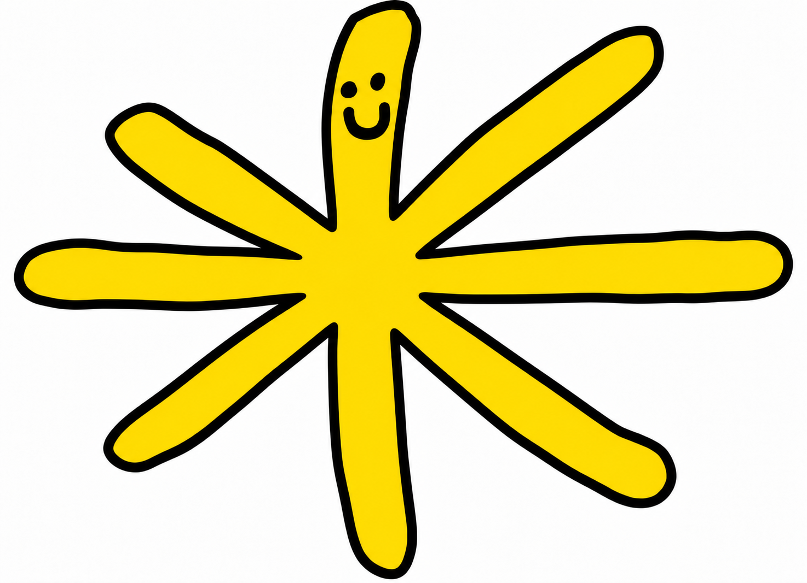

# 아이리스 3D (Iris 3D)

태호 오빠의 마스코트 **아이리스**를 원본 그림 그대로 3D로 옮긴 모델과 4K 30fps 애니메이션이에요.

| 원본 | 3D (정면, 정지 포즈) |
|---|---|
|  |  |

## 결과물

| 파일 | 내용 |
|---|---|
| `model/iris.obj` + `model/iris.mtl` | 정지 포즈(원본 그림과 같은 모양) 3D 모델이에요. 닫힌 스무스 메시(삼각형 156,834개)이고 노멀이 들어 있어요. Y축이 위, 얼굴은 +Z 쪽, 바닥은 y = 0, 허브는 x = 0이에요 |
| `model/iris.blend` | 블렌더 원본 씬: 모델, 리그(뼈대), 애니메이션, 조명, 그림자, 카메라 3대 |
| `renders/iris_front_tilt_4k30.mp4` | 정면에서 15° 위 카메라, 3840×2160, 30fps, 3초(90프레임) |
| `renders/iris_front_4k30.mp4` | 완전 정면(직교 카메라), 3840×2160, 30fps, 3초 |
| `renders/iris_orbit_4k30.mp4` | 카메라가 좌우로 ±20° 천천히 흔들려요, 3840×2160, 30fps, 3초 |
| `renders/still_front_rest.png`, `renders/still_front_tilt_rest.png` | 정지 포즈 4K 스틸 이미지 |
| `unity/` | Unity uGUI 뷰어. 회전, 재생/정지, 카메라 3종 전환을 할 수 있어요 ([unity/README.md](unity/README.md)) |

영상은 H.264 High 5.1, BT.709이라서 대부분의 기기에서 재생돼요.

## 원본 지키기 (변형·색상 변경 금지)

- **실루엣**: 그림의 외곽선을 서브픽셀 단위로 따서 메시 경계로 그대로 썼어요. 정면에서 보면 원본 그림과 같은 모양이에요.
- **검은 외곽선**: 그림에서 잰 두께(약 18px)를 그대로 써서 납작한 검은 테두리로 만들었어요. 노란 몸통은 그 안쪽에서 볼록하게 부풀어요. 그래서 정면뿐 아니라 15° 위나 ±20° 옆에서 봐도 외곽선 두께가 비슷하게 보여요.
- **눈·입**: 그림의 눈 2개와 웃는 입 모양을 메시 경계로 그대로 넣었어요. 튀어나온 스티커가 아니라 표면과 같은 높이예요.
- **색상**: 노랑 `#FEDB02 (254, 219, 2)`, 검정 `#000000`. 둘 다 그림에서 직접 측정했어요.
  - 렌더: 블렌더 컬러 관리를 *Standard*로 두고 조명을 보정했어요. 그래서 하이라이트가 아닌 노란 면이 원본 색 그대로 나와요(측정값 253.6, 218.3, 4.7).
  - MTL: `Kd`에 sRGB 값을 그대로 적었어요. three.js, Maya, 3ds Max, Windows 3D 뷰어, Unity는 이 값을 그대로 읽어요.
  - ⚠️ **블렌더**의 OBJ 임포터만 `Kd`를 선형 값으로 읽어서 노랑이 연하게 보여요. 블렌더에서는 `model/iris.blend`를 열어 주세요. OBJ를 가져온 경우에는 Base Color의 Hex를 `FEDB02`로 바꿔 주세요.
- **얼굴 보호**: 얼굴이 있는 마디는 애니메이션 중에도 늘어나거나 줄어들지 않는 단단한 마디예요. 얼굴은 모양 그대로 움직이기만 해요(검증 오차 0.0005px).

## 애니메이션 (참고 GIF 기반)

참고 GIF는 1초짜리 루프예요. 덩어리 → 가시가 '팍' 뻗음 → 살짝 튕김 → 유지하며 떨림 → 쏙 들어감 순서로 움직여요.
아이리스의 줄기 8개는 각각 마디 5개로 되어 있어요. 허브 쪽 4개는 접히는 마디이고, 끝 1개는 둥근 끝 모양을 지키는 단단한 마디예요.

1. **접힘(1~5프레임)**: 마디마디가 허브 쪽으로 접혀 있어요. 허브 쪽 마디는 45%, 가운데는 25%, 끝 쪽은 50%까지 접혀서 줄기 전체 길이가 원래의 약 60%가 돼요.
2. **팍!**: 허브 쪽 마디부터 1.2프레임 간격으로 차례로 펴지면서(마디마디 물결) 원래 길이를 살짝 넘었다가 튕기듯 돌아와요.
3. **꿈틀**: 다 뻗은 동안 마디마디를 따라 물결처럼 흔들려요. GIF에서 가시가 떨리는 부분이에요.
4. **쏙**: 다시 허브 쪽으로 접혀 들어가요.

줄기마다 시작 시점이 조금씩 달라서 GIF처럼 자연스러워요. 30프레임(1초)마다 정확히 반복돼요(이음매 없는 루프).
줄기는 옆 줄기와 갈라지는 지점부터 접혀서, 접힌 상태에서도 줄기끼리 파고들거나 외곽선이 꼬이지 않아요.
얼굴이 있는 위쪽 줄기는 얼굴을 지키려고 다른 줄기보다 덜 접혀요.

## 조명, 그림자, 반사

- 왼쪽 앞 위에서 오는 키 라이트(부드러운 그림자)와 왼쪽 뒤 위에서 오는 림 라이트를 썼어요.
- 하얀 스튜디오(바닥과 둥근 뒷벽)에 아이리스의 그림자가 떨어져요. 그림자와 아이리스 바로 주변의 은은한 음영을 빼면 배경은 흰색(255)이에요.
- 표면에 클리어코트를 입혀서 위쪽 소프트박스와 조명의 반사 하이라이트가 보여요.
- 렌더는 Cycles(CPU)를 썼어요. 아이리스는 4K로, 부드러운 그림자는 1/4 해상도로 렌더한 다음 흰 배경 위에 합성했어요(`scripts/composite_iris.py`).

## 다시 만들기

```bash
pip install opencv-python-headless scipy triangle      # 그림 추적용
python3 scripts/trace_iris.py source/iris.png build    # 그림 → 메시 데이터
scripts/blender.sh -b --factory-startup --python-exit-code 1 --python scripts/build_iris.py -- \
    --trace build/iris_trace.npz --meta build/iris_trace.json \
    --blend model/iris.blend --obj model/iris.obj       # 씬, 리그, 애니메이션, OBJ/MTL
scripts/blender.sh -b model/iris.blend --python scripts/verify_iris.py -- --out build/verify
python3 scripts/compare_iris.py source/iris.png build/verify   # 원본과 비교 → build/verify/compare.json ("all_pass")
rm -rf build/frames build/stills && scripts/render_all.sh      # 4K 렌더 + 합성 + MP4 인코딩 (CPU 4코어에서 약 5시간)
scripts/blender.sh -b model/iris.blend --python scripts/export_unity_fbx.py -- \
    --out unity/Assets/IrisViewer/Models/iris_unity.fbx   # Unity용 FBX
```

- `scripts/blender.sh`는 블렌더 내장 파이썬에서 numpy를 쓸 수 있게 해 줘요. blender.org 공식 빌드에는 numpy가 이미 들어 있어서 그냥 `blender`로 실행해도 돼요. Blender 4.0.2로 만들고 확인했어요.
- `render_all.sh`는 다 된 프레임을 건너뛰어요. 씬을 바꿨다면 `build/frames`를 먼저 지워 주세요. 프레임이 하나라도 빠지면 인코딩을 멈추고 오류를 내요.

## 검증 결과

`verify_iris.py`와 `compare_iris.py`로 확인한 값이에요(`build/verify/compare.json`).

| 항목 | 결과 |
|---|---|
| 실루엣 (정면 3D 렌더 vs 원본 그림) | IoU 0.998, 경계 평균 오차 0.13px |
| 검은 외곽선 두께 (정면) | 18.36px (원본 18.38px), 외곽선 영역 IoU 0.989 |
| 검은 외곽선 두께 (15° 위, ±20° 옆) | 줄기 위아래·좌우 모두 14~19px (원본 약 18px) |
| 눈·입 | IoU 0.948 (차이는 경계의 안티앨리어싱 0.3px 이하) |
| 노란색 (빛 받는 면의 중앙값) | (253.6, 218.3, 4.7) vs 원본 (254, 219, 2) |
| 얼굴 변형 (애니메이션 중) | 최대 0.0005px |
| 루프 이음매 (1프레임 vs 31·61프레임) | 오차 0 |
| 접힌 상태 외곽선 꼬임 | 30프레임 모두 0 |
| 카메라 3대 | 모든 프레임에서 아이리스 전체가 화면 안에 들어와요 |
| OBJ | 닫힌 매니폴드 메시(구멍 없음), 노멀 바깥쪽, 정지 포즈 = 원본 모양 |
